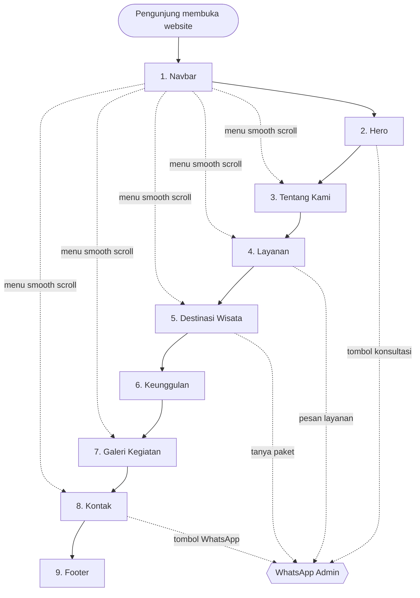

# Alur Website Company Profile Nirwana Tour Lampung

Dokumen ini menjelaskan alur halaman (page flow) website company profile **Nirwana Tour Lampung**. Website dibuat dengan HTML, CSS, dan JavaScript dalam format satu halaman (single page) yang bersifat profesional untuk perusahaan travel.

---

## 1. Diagram alur



Keterangan:
- Garis tebal: urutan scroll dari atas ke bawah.
- Garis putus-putus ke `WhatsApp Admin`: titik konversi (pengunjung menjadi calon pelanggan).
- Garis putus-putus dari `Navbar`: lompatan cepat lewat menu.

---

## 2. Rincian setiap bagian

| No | Bagian | Isi | Tujuan | Aksi pengunjung |
|----|--------|-----|--------|-----------------|
| 1 | Navbar | Logo Nirwana Tour, menu Beranda, Tentang Kami, Layanan, Destinasi, Galeri, Kontak | Navigasi utama | Klik menu, scroll ke bagian terkait |
| 2 | Hero | Headline "Jelajahi Dunia, Ciptakan Cerita", gambar perjalanan, tombol konsultasi WhatsApp | Kesan pertama dan ajakan bertindak | Klik tombol WhatsApp atau lanjut scroll |
| 3 | Tentang Kami | Profil perusahaan dan gambaran layanan | Membangun kepercayaan | Membaca |
| 4 | Layanan | Wisata, study tour, kunjungan industri, transportasi rombongan | Menjelaskan produk | Klik "Pesan layanan ini" (WhatsApp) |
| 5 | Destinasi Wisata | Galeri destinasi dan inspirasi perjalanan | Memberi inspirasi dan memancing minat | Klik "Tanya paket ini" (WhatsApp) |
| 6 | Keunggulan | Alasan memilih Nirwana Tour Lampung | Meyakinkan calon pelanggan | Membaca |
| 7 | Galeri Kegiatan | Dokumentasi perjalanan yang dapat diklik | Bukti pengalaman nyata | Klik foto, lightbox terbuka |
| 8 | Kontak | Informasi kontak dan tombol WhatsApp | Konversi akhir | Klik WhatsApp, telepon, atau email |
| 9 | Footer | Identitas perusahaan dan tautan media sosial | Penutup dan referensi | Klik tautan media sosial |

---

## 3. Alur navigasi tambahan

1. **Smooth scroll**: klik menu Navbar membuat halaman bergulir halus ke bagian yang dituju.
2. **Menu mobile**: pada layar kecil, Navbar berubah menjadi menu hamburger.
3. **Lightbox galeri**: foto di Galeri Kegiatan terbuka sebagai pop-up. Pengunjung dapat menutupnya atau menggeser ke foto berikutnya tanpa meninggalkan halaman.
4. **Tombol WhatsApp**: seluruh tombol konsultasi membuka `https://wa.me/<nomor>?text=<pesan awal>` dengan pesan awal yang sudah terisi.

---

## 4. Titik konversi WhatsApp

| Lokasi | Teks tombol (usulan) | Pesan awal (usulan) |
|--------|----------------------|---------------------|
| Hero | Konsultasi via WhatsApp | Halo Nirwana Tour, saya ingin konsultasi perjalanan. |
| Layanan | Pesan layanan ini | Halo Nirwana Tour, saya tertarik dengan layanan [nama layanan]. |
| Destinasi | Tanya paket ini | Halo Nirwana Tour, saya ingin info paket wisata ke [nama destinasi]. |
| Kontak | Hubungi kami | Halo Nirwana Tour, saya ingin bertanya. |

---

## 5. Struktur file yang disarankan

```
nirwana-tour-lampung/
├── index.html
├── css/
│   └── style.css
├── js/
│   └── script.js
└── assets/
    ├── images/
    │   ├── hero/
    │   ├── destinasi/
    │   └── galeri/
    └── logo/
```

---

## 6. Tahap pengerjaan

1. Kumpulkan konten: teks profil, daftar layanan, daftar destinasi, foto, logo, nomor WhatsApp, alamat, dan akun media sosial.
2. Susun kerangka HTML sesuai 9 bagian di atas.
3. Buat tampilan dengan CSS: palet warna, tipografi, grid, dan responsif.
4. Tambahkan JavaScript: smooth scroll, menu hamburger, lightbox galeri, dan tautan WhatsApp.
5. Uji di ponsel dan komputer, lalu perbaiki.
6. Publikasikan (hosting dan domain).
